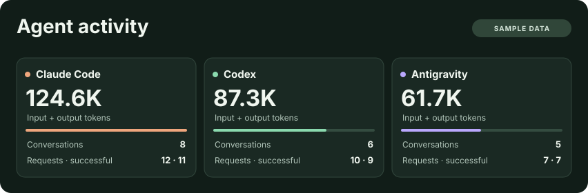

# Agent Activity Card

Show token counts, conversations, and request results in a GitHub profile or project README. The preview uses sample data.



## Use your own numbers

1. Select **Use this template** on GitHub, or copy these files into your repository.
2. Edit `activity.json` with your own aggregates and set `sample` to `false`. Use `null` for an unmeasured token count.
3. Run `node render.mjs` from the repository with Node.js 22 or later. Commit `usage.svg` and reference it from your README.

```markdown

```

Use the same time range and token-counting convention for every agent you compare. The generator takes the aggregates you supply and runs locally with no dependencies or account setup.

日本語では、`activity.json` の集計値を自分の数字に差し替え、`node render.mjs` で生成した `usage.svg` をREADMEに貼るだけ。コピー・改変は [MIT License](./LICENSE) の条件でどうぞ。
